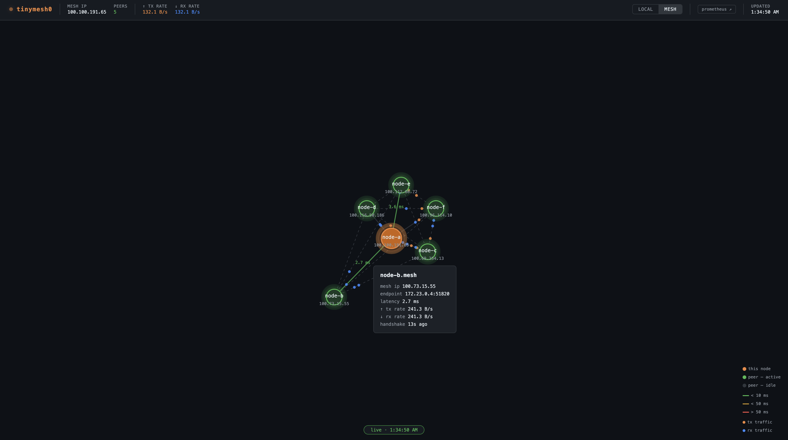

```
 _   _                                  _        ___
| |_(_)_ __  _   _ _ __ ___   ___  ___| |__    / _ \
| __| | '_ \| | | | '_ ` _ \ / _ \/ __| '_ \  | | | |
| |_| | | | | |_| | | | | | |  __/\__ \ | | | | |_| |
 \__|_|_| |_|\__, |_| |_| |_|\___||___/_| |_|  \___/
             |___/
```

> **Peer pressure, but encrypted.**

> This fork requires shared-key authenticated, encrypted gossip enrollment.
> All members must configure `gossip.key-file`; plaintext upstream nodes cannot join.
> See [ENROLLMENT.md](docs/ENROLLMENT.md) for setup and trust limits.
> This enrollment patch has local tests; it is not a production deployment or a full security audit.

[](https://golang.org)
[](LICENSE)



---

## What is tinymesh0?

tinymesh0 is a cryptographically secure, decentralized mesh WireGuard VPN with gossip-based node discovery and per-node access policy enforcement. tinymesh0 connects machines across the internet into a private encrypted network — like Tailscale or ZeroTier, but built from scratch. Every node is equal: there is no central server, no account required, and no single point of failure.

Each node:
- Gets a **stable private IP** derived deterministically from its cryptographic identity
- **Discovers its own public endpoint** via STUN (no manual IP configuration)
- Establishes **encrypted WireGuard tunnels** directly to every peer
- Enforces **per-node access policy** at the network layer
- Participates in **gossip-based peer discovery** — nodes find each other automatically

---

## How it works

```
  node-a (home)                                    node-b (cloud)
┌────────────────────┐                         ┌────────────────────┐
│  100.75.167.232    │                         │  100.117.163.169   │
│  tinymesh0         │◀── WireGuard / UDP ────▶│  tinymesh0         │
│  203.0.113.5:51820 │     (encrypted)         │  198.51.100.9:51820│
└────────────────────┘                         └────────────────────┘
```

- **Identity** — each node's public key (Curve25519) is its identity. The mesh IP is a SHA-256 hash of that key, mapped into `100.64.0.0/10`.
- **Discovery** — STUN tells each node its own public IP without any central registry.
- **Encryption** — WireGuard (ChaCha20-Poly1305 + Noise protocol) encrypts all traffic between nodes.
- **No coordinator** — gossip (SWIM protocol) propagates peer state across the mesh.

> **Address space note:** `100.64.0.0/10` is designated by [RFC 6598](https://datatracker.ietf.org/doc/html/rfc6598) as "Shared Address Space" for ISP Carrier-Grade NAT (CGN) deployments — not for general private overlay use. tinymesh0 uses it anyway, following the same precedent as Tailscale: the range is non-routable on the public internet and is unlikely to conflict with RFC 1918 ranges already used by home routers and corporate VPNs. The known risk is address collision on networks where the ISP itself uses CGN (common with some mobile carriers and residential ISPs). If you operate in such an environment, consider overriding the subnet in `internal/ipam/ipam.go` to use `172.16.0.0/12` instead.

For a detailed technical walkthrough, see [HOW_IT_WORKS.md](HOW_IT_WORKS.md).

---

## Getting started

### Prerequisites

- Linux (kernel 5.6+ for built-in WireGuard support)
- Go 1.24+
- Root / `CAP_NET_ADMIN` (required to create network interfaces)

### Build

```bash
git clone https://github.com/neruok/tinymesh0
cd tinymesh0
make build
```

| Target | Description |
|---|---|
| `make build` | Compile `tinymesh0d` binary |
| `make test` | Run all unit tests |
| `make lint` | Run golangci-lint (downloads on first use via `go run`) |
| `make dev` | Generate keys, build configs, and launch a two-node Docker mesh |
| `make dev-large` | Generate keys, build configs, and launch a six-node Docker mesh with varied policy configurations |
| `make release` | Run `build → test → lint` in sequence; fails fast on any error |

### Provision the shared mesh key

Every member must have the same enrollment key before starting. Generate it once
in a private directory, then distribute it through an existing trusted channel:

```bash
umask 077
head -c 32 /dev/urandom | base64 > gossip.key
chmod 600 gossip.key
```

Set `gossip.key-file` to that node's copy. Keep it separate from each node's
WireGuard private key; do not put the key contents in YAML, arguments, logs or Git.
The key file must be a regular file readable only by its owner. Missing, malformed
or group/world-accessible keys stop startup before WireGuard, DNS or network
discovery. See [the enrollment trust model](docs/ENROLLMENT.md).

The two-node and six-node development setup scripts generate a shared key for
their respective disposable meshes and mount it read-only into every container.
Rerunning a setup script replaces that development mesh's credentials.

### Generate a keypair

```bash
./tinymesh0d keygen
# private-key: <base64>
# public-key:  <base64>
```

Share your **public key** and your **public IP:port** with the nodes you want to connect.

### Configure

Copy the example config and edit it:

```bash
cp tinymesh0.example.yaml tinymesh0.yaml
```

```yaml
hostname: mynode
listen-port: 51820
key-file: ./tinymesh0.key

stun-servers:
  - stun.l.google.com:19302
  - stun.cloudflare.com:3478

gossip:
  key-file: ./gossip.key
  bind-port: 7946
  retry-join: 10
  bootstrap-peers:
    - "seed-node.example.com:7946"  # omit if this node is the seed
```

After the shared mesh key is provisioned, peers are discovered automatically via authenticated, encrypted gossip — no manual WireGuard public-key exchange is required.

### advertise-endpoint

By default, tinymesh0 uses STUN to discover its public IP and broadcasts that to peers via gossip. Set `advertise-endpoint` to override this when STUN gives the wrong answer:

| Scenario | Value |
|---|---|
| Public internet (default) | *(leave unset — STUN handles it)* |
| Docker / local network | `"node-a:51820"` (hostname Docker DNS resolves) |
| Known static public IP | `"203.0.113.5:51820"` |
| Behind a load balancer or proxy | `"vpn.example.com:51820"` |

```yaml
advertise-endpoint: "vpn.example.com:51820"
```

### Run

```bash
sudo ./tinymesh0d up -c tinymesh0.yaml
```

```
public key : oBdaXbwzjm01c60kFOjhxToB1duJHpjZ7J0KFMFBTDg=
mesh IP    : 100.75.167.232
discovering public endpoint via STUN...
public endpoint: 216.243.46.97:51820
tinymesh0 is up
gossip listening on :7946
joined cluster via [seed-node.example.com:7946]
gossip: peer joined — node-b  mesh=100.117.163.169  endpoint=198.51.100.9:51820
```

### Commands

| Command | Description |
|---|---|
| `tinymesh0d up -c <config>` | Bring up the mesh interface |
| `tinymesh0d down` | Take down the mesh interface |
| `tinymesh0d status` | Show interface and peer status |
| `tinymesh0d keygen` | Generate a new WireGuard keypair |
| `tinymesh0d policy list` | Print the active iptables policy chain |
| `tinymesh0d policy reload` | Signal the running daemon to reload policy from config (SIGHUP) |
| `tinymesh0d dns list` | Show the hostname → mesh IP table |
| `tinymesh0d status --web` | Open the topology UI in a browser |

---

## Local development with Docker

You can simulate a two-node mesh on a single machine using Docker Compose.

```bash
make dev
```

This generates keys, writes per-node configs, and starts both containers. To verify the tunnel:

```bash
# Check peer status on node-b
docker exec node-b tinymesh0d status

# Ping node-a's mesh IP from node-b
docker exec node-b ping 100.75.167.232
```

You should see sub-millisecond ping times and a confirmed WireGuard handshake.

---

## Large network testing

`make dev-large` launches a six-node mesh with a different policy configuration on each node, covering the main policy patterns: open, blocklist, allowlist, peer-specific rules, and quarantine.

```bash
make dev-large
```

`scripts/setup-large-net.sh` generates all keys, configs, and `docker-compose.large.yml`, then Docker Compose builds and starts the containers. The topology UI is served by node-a at `http://localhost:8080`.

### Policy matrix

| Node | Default | Rules | Model |
|---|---|---|---|
| `node-a` | open | none | Seed / unrestricted |
| `node-b` | allow | deny ports 9999, 2112 | Blocklist specific ports |
| `node-c` | deny | allow ports 80, 443, 8080 | Web-only allowlist |
| `node-d` | deny | allow node-a/node-b → 5432; allow \* → 8080 | Database server — trusted peers only |
| `node-e` | allow | deny node-f → 22; deny node-f → 3306 | Peer-specific block for an untrusted node |
| `node-f` | deny | allow \* → 8080 | Quarantine — HTTP health checks only |

### Verify the policies

**Check that all six nodes have formed a mesh:**

```bash
docker exec node-a-lg tinymesh0d status
```

Expected: five peers listed with active WireGuard handshakes.

**Confirm policy chains are installed on each node:**

```bash
for n in node-a-lg node-b-lg node-c-lg node-d-lg node-e-lg node-f-lg; do
  echo "=== $n ==="; docker exec $n tinymesh0d policy list
done
```

**node-b: blocked port is dropped, allowed port passes**

```bash
# Terminal 1 — listener on the blocked port inside node-b
docker exec node-b-lg ncat -l 9999

# Terminal 2 — attempt from node-a (times out — DROPped by node-b's policy)
docker exec node-a-lg ncat -w 2 node-b.mesh 9999

# Terminal 3 — attempt on an allowed port (succeeds)
echo "hello" | docker exec -i node-a-lg ncat -w 2 node-b.mesh 8080
```

**node-c: default deny — only web ports pass**

```bash
# This should succeed (port 8080 is allowed)
echo "hello" | docker exec -i node-a-lg ncat -w 2 node-c.mesh 8080

# This should time out (port 9000 is not in node-c's allow list)
docker exec node-a-lg ncat -w 2 node-c.mesh 9000
```

**node-d: only node-a and node-b may reach the database port**

```bash
# From node-a — allowed (node-a is in node-d's allow list for port 5432)
docker exec node-a-lg ncat -w 2 node-d.mesh 5432 && echo "connected"

# From node-e — dropped (node-e is not permitted)
docker exec node-e-lg ncat -w 2 node-d.mesh 5432 && echo "connected" || echo "blocked"
```

**node-e: node-f is blocked on sensitive ports, others are not**

```bash
# From node-f — dropped on port 22
docker exec node-f-lg ncat -w 2 node-e.mesh 22 && echo "connected" || echo "blocked"

# From node-a — succeeds on the same port (node-a is not restricted)
docker exec node-a-lg ncat -w 2 node-e.mesh 22 && echo "connected"
```

**node-f: quarantine — only port 8080 responds**

```bash
# Port 8080 is allowed
echo "hello" | docker exec -i node-a-lg ncat -w 2 node-f.mesh 8080

# Any other port is dropped
docker exec node-a-lg ncat -w 2 node-f.mesh 5432 && echo "connected" || echo "blocked"
```

**Live reload — change a policy without restarting**

With the mesh running, edit `configs-large/node-b.yaml` on the host (add or remove a rule), then signal the daemon:

```bash
docker exec node-b-lg tinymesh0d policy reload
```

The daemon reinstalls the iptables chain immediately. The WireGuard sessions remain active throughout.

---

## Testing

Automated configuration and loopback enrollment tests cover accepted shared keys, missing/invalid/insecure key files, wrong-key and plaintext join rejection, and the peer-sync boundary. Run `go test ./...`. These tests do not create WireGuard interfaces or change DNS/firewalls. Actual WireGuard, DNS and policy behavior still requires isolated runtime testing.

### Tunnel verification

```bash
make dev

# Confirm peer is visible on node-b
docker exec node-b tinymesh0d status

# Ping node-a's mesh IP from node-b (get the IP from the status output)
docker exec node-b ping <node-a-mesh-ip>
```

### Policy engine verification

The policy engine requires `iptables` inside the containers (included in the Docker image). Before running `make dev`, add a `policy` block to `configs/node-b.yaml` — or edit it after running `bash scripts/setup-dev.sh` and before running `docker compose up --build`.

**Example: deny one port, allow everything else**

```yaml
# configs/node-b.yaml
policy:
  default: allow
  rules:
    - deny: "* -> * port 9999"
```

**1. Confirm the chain was created**

```bash
docker exec node-b tinymesh0d policy list
```

Expected output shows the DROP rules for port 9999 (one for TCP, one for UDP) followed by the chain reference count in INPUT.

**2. Confirm denied traffic is actually dropped**

```bash
# Terminal 1 — start a listener on the denied port inside node-b
docker exec node-b ncat -l 9999

# Terminal 2 — try to connect from node-a (times out; packet is DROPped)
docker exec node-a ncat -w 2 <node-b-mesh-ip> 9999
```

The connection attempt on node-a should hang for 2 seconds and exit with no output. The listener on node-b receives nothing.

**3. Confirm allowed traffic still flows**

```bash
# Terminal 1 — listen on an allowed port
docker exec node-b ncat -l 8080

# Terminal 2 — connect and send data
echo "hello" | docker exec -i node-a ncat -w 2 <node-b-mesh-ip> 8080
```

"hello" should appear in node-b's terminal.

**4. Test a hostname-based rule with default deny**

```yaml
# configs/node-b.yaml
policy:
  default: deny
  rules:
    - allow: "node-a -> * port 8080"
```

With this config, only node-a reaching port 8080 is permitted. All other inbound mesh traffic is dropped. Verify with the same ncat steps above — port 8080 from node-a works, any other port or source does not.

**5. Test live policy reload without restarting**

With the mesh running, edit `configs/node-b.yaml` on the host (add or remove a rule), then signal the daemon:

```bash
docker exec node-b tinymesh0d policy reload
```

The daemon logs `policy reloaded` and immediately reinstalls the iptables chain. The WireGuard session remains active throughout. Re-run `tinymesh0d policy list` to confirm the rules changed.

**What to watch in the logs**

```
node-b  | policy engine active (1 rules, default=allow)
node-b  | policy: deferring rule (unresolved hostname): node-a→*
node-b  | gossip: peer joined — node-a  mesh=100.x.x.x  endpoint=...
```

The "deferring rule" line is expected — hostname-based rules are skipped until gossip delivers the peer's NodeState and resolves the name to a mesh IP. The rule is installed automatically on peer join.

---

## Mesh DNS

Each node runs an authoritative DNS resolver for the `.mesh` zone, bound to its own mesh IP on port 53 (UDP + TCP). Hostname-to-IP mappings are sourced directly from gossip state: when a peer joins, its entry is added instantly; when it leaves, the entry is removed.

No config changes are required — the DNS server starts automatically with `tinymesh0d up`.

### Automatic resolver configuration

The daemon manages `/etc/resolv.conf` automatically:

1. **At startup** — reads the current nameservers from `/etc/resolv.conf` and stores them as forwarding upstreams, then replaces the file with a single `nameserver <mesh-ip>` line.
2. **At shutdown** — restores the original `/etc/resolv.conf`.

This means `.mesh` names resolve without any `@server` flag, and non-`.mesh` queries (container names, public internet) are transparently forwarded to whatever resolver was configured before. No manual step is required.

Startup log lines confirm both actions:

```
mesh dns listening on 100.75.167.232:53 (forwarding to [127.0.0.11:53])
mesh dns: set /etc/resolv.conf nameserver to 100.75.167.232 (restoring on shutdown)
```

> **Note:** On systems running `systemd-resolved` (most Ubuntu/Debian installations), `/etc/resolv.conf` is a symlink managed by the system — writes to it may be ignored or overwritten. Use `resolvectl dns tinymesh0 <mesh-ip>` and `resolvectl domain tinymesh0 mesh` to confine `.mesh` queries to the interface instead.

### Verify DNS resolution and forwarding

No manual resolver configuration is needed. After `make dev`, the daemon sets `/etc/resolv.conf` automatically.

```bash
# 1. Show known hostname → IP mappings
docker exec node-b tinymesh0d dns list

# 2. Resolve a peer's mesh name — no @ flag required
docker exec node-b dig node-a.mesh

# 3. Confirm forwarding: non-.mesh names still resolve
docker exec node-b dig google.com

# 4. Confirm Docker container names still resolve (forwarded to 127.0.0.11)
docker exec node-b dig node-a

# 5. Use mesh names directly in commands
docker exec node-b ping node-a.mesh
docker exec node-b curl http://node-a.mesh:8080
```

Expected `dns list` output:

```
HOSTNAME                  MESH IP
node-a.mesh               100.75.167.232
node-b.mesh               100.117.163.169
```

Expected `dig node-a.mesh` output (no `@` needed after resolv.conf update):

```
;; ANSWER SECTION:
node-a.mesh.		60	IN	A	100.75.167.232
```

Expected `dig google.com` output (forwarded to upstream, returns real answer):

```
;; ANSWER SECTION:
google.com.		300	IN	A	142.250.80.46
```

### How it works

The DNS server registers two handlers in the `miekg/dns` mux, which routes by longest matching zone:

| Zone | Handler | Behaviour |
|---|---|---|
| `mesh.` | authoritative | Returns an `A` record from the gossip peer table (TTL 60 s) |
| `.` (catch-all) | forwarding | Proxies the query to upstream resolvers; retries over TCP if the UDP response is truncated |

Unknown `.mesh` names return `NXDOMAIN`. Non-`A` queries for known `.mesh` names return `NODATA`. All other queries are forwarded.

The state file at `/var/run/tinymesh0d-dns.json` is rewritten on every peer join/leave and is what `tinymesh0d dns list` reads.

---

## Topology UI

Each daemon serves a live network graph at `http://<node-addr>:8080`. The UI is a single embedded HTML page — no external files, no install step.

**Header bar** — always visible at the top: hostname, mesh IP, public endpoint, connected peer count, and live aggregate TX/RX bandwidth rates updated every 3 seconds.

**Graph canvas** — D3 force-directed graph. Nodes settle into a stable layout and stay put as stats update; only a structural change (peer joining or leaving) re-energizes the simulation.

**What it shows:**

| Element | Meaning |
|---|---|
| Orange node | This node (self) |
| Colored node | Peer with an active WireGuard handshake (< 5 min ago); color reflects latency |
| Dark/gray node | Peer known via gossip but no active handshake |
| Edge color | Latency-mapped: green < 5 ms → yellow < 50 ms → red > 50 ms |
| Edge opacity | Full = connected; faded = disconnected or unmeasured |
| Dotted edge | Peer-to-peer link (mesh view); solid = link to/from self |
| Traffic particles | Animated dots flowing along edges — orange = TX, blue = RX; size scales with bandwidth |
| Click node | Opens a detail panel with endpoint, latency, handshake age, bytes sent/received |

**View toggle** — switch between two perspectives using the **Local / Mesh** buttons in the top-right corner:

| Mode | What it shows |
|---|---|
| Local | Star topology centered on this node — only direct connections to self |
| Mesh | All-pairs topology — every peer-to-peer edge in the network; unmeasured links shown as dotted |

**Access the UI:**

The server listens on `0.0.0.0:8080` by default, so it is reachable on any interface. Open it in a browser:

```bash
# From a browser on your local machine (when port 8080 is reachable)
open http://<node-ip>:8080

# Or use the CLI shortcut (prints the URL and attempts to open the browser)
tinymesh0d status --web

# Override the default address if the daemon uses a different port
tinymesh0d status --web --addr <host>:8080
```

**Configure the listen address:**

```yaml
# tinymesh0.yaml
topology:
  listen-addr: "0.0.0.0:8080"   # default
  # listen-addr: ""             # set empty to disable the UI entirely
```

**API endpoints:**

| Endpoint | Description |
|---|---|
| `GET /` | Embedded D3.js topology UI |
| `GET /api/topology` | JSON snapshot of self + peers with WireGuard stats |
| `GET /api/stream` | SSE stream — emits a `topology` event on every state change |
| `GET /metrics` | Prometheus text-format metrics (peer count, handshake age, bytes, latency) |

The SSE stream sends an initial `topology` event on connect so the UI renders immediately without waiting for a peer join/leave event. The `/metrics` endpoint is compatible with any Prometheus scrape config — add `http://<node-ip>:8080/metrics` as a target.

---

## Roadmap

| Phase | Status | Description |
|---|---|---|
| 1 — Core tunnel | ✅ Done | WireGuard interface management, STUN discovery |
| 2 — Gossip | ✅ Done | SWIM-based peer discovery, dynamic WireGuard config, no static peers |
| 3 — Policy engine | ✅ Done | Per-node allow/deny rules enforced via iptables, live reload via SIGHUP |
| 4 — Mesh DNS | ✅ Done | Authoritative `.mesh` resolver on each node; hostname → IP from gossip |
| 5 — Topology UI | ✅ Done | Live D3.js graph; SSE stream; ICMP latency probes; embedded binary assets |

---

## Architecture

```
tinymesh0
├── cmd/tinymesh0d/       CLI entry point (cobra)
├── internal/
│   ├── cli/              CLI command implementations (down, status, dns list, …)
│   ├── config/           YAML config loader
│   ├── dns/              Authoritative .mesh DNS resolver (miekg/dns)
│   ├── gossip/           SWIM-based peer discovery (memberlist)
│   ├── ipam/             Deterministic mesh IP assignment
│   ├── policy/           iptables policy engine (allow/deny rules)
│   ├── stun/             STUN client (RFC 5389, from scratch)
│   ├── tm0d/             Daemon lifecycle (startup, shutdown, subsystem wiring)
│   ├── topology/         HTTP topology server + embedded D3 UI
│   └── wireguard/        Interface lifecycle via wgctrl + netlink
└── scripts/              Development utilities
```

---

## License

MIT
